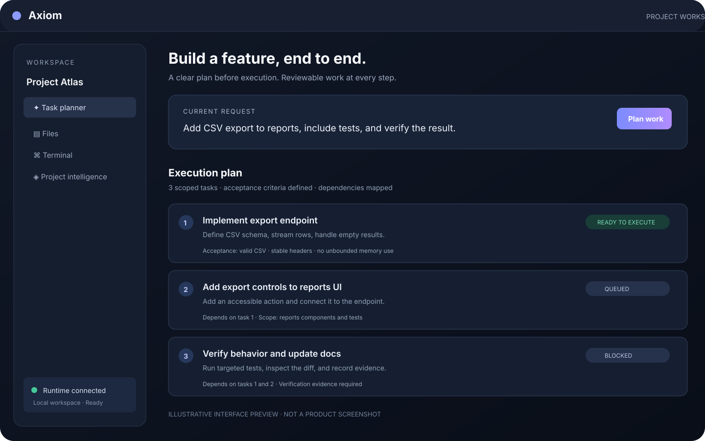
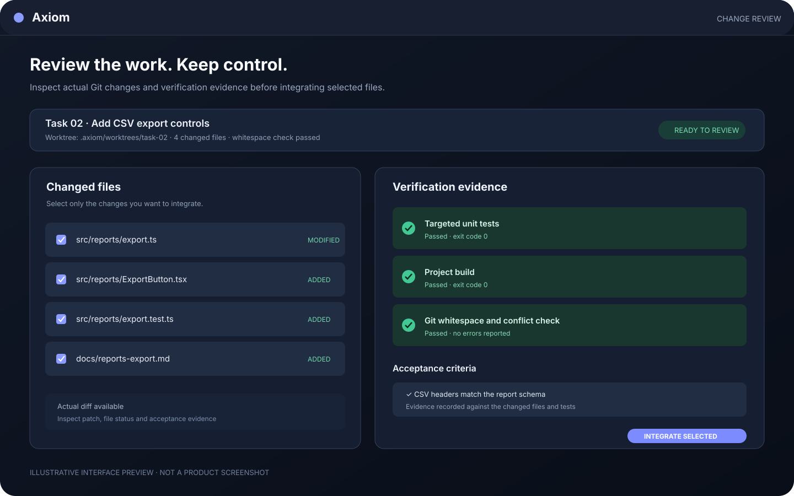

# Axiom

**Build software by describing the outcome—not by starting with a pile of files.**

Axiom is an AI-first desktop workspace for planning, implementing, and verifying software changes. Describe the outcome, review a structured plan, let isolated workers handle scoped tasks, then inspect real diffs and verification evidence before integrating anything.

<p align="center">
  <a href="media/axiom-task-planner.svg"></a>
  <a href="media/axiom-worktree-review.svg"></a>
</p>
<p align="center"><sub>Illustrative interface previews. They communicate the workflow and are not captured product screenshots.</sub></p>

## Download

Get the latest published installers from the **[Axiom Releases page](https://github.com/michaelkage/Axiom/releases)**.

| Platform | Package | Availability |
| --- | --- | --- |
| Windows x64 | NSIS installer (.exe) | Release workflow builds and smoke-tests installation and first launch |
| macOS Intel and Apple Silicon | DMG and ZIP | CI builds both architectures; signed release assets require Apple signing and notarization secrets |
| Linux x64 | AppImage, DEB, RPM | Release workflow builds packages on Ubuntu |

A published release contains downloadable assets. A successful CI artifact upload alone is not a published release. See [platform and release details](docs/RELEASE_PROCESS.md).

## What you can do

- **Plan work:** turn a feature request into scoped tasks, dependencies, and acceptance criteria.
- **Delegate safely:** isolate task changes in Git worktrees where supported.
- **Review actual changes:** inspect Git diffs, select files, and integrate only what you approve.
- **Verify the result:** run repository-aware quality checks and inspect their real output.
- **Repair deliberately:** send failed check output back for a bounded correction attempt.
- **Keep project context:** save conventions, decisions, architecture notes, and fixes in versioned project memory.
- **Work directly in the project:** browse files, use a terminal, and manage remote workspaces from the desktop app.

Axiom is a standalone Electron application. It does not require VS Code or an editor extension.

## Quick start

1. Install Axiom from the [Releases page](https://github.com/michaelkage/Axiom/releases).
2. Launch Axiom and select a project folder.
3. Configure a supported hosted or local model provider.
4. Describe a concrete outcome, such as: “Add CSV export to reports, include tests, and explain the changes.”
5. Review the plan, task scopes, and acceptance criteria.
6. Inspect changed files, diffs, and verification results.
7. Integrate only the changes you approve.

For a guided walkthrough, see [Quick start](docs/QUICKSTART.md).

## Project memory

Desktop project memory is stored in `.axiom/memory.json` inside the selected repository. It contains user-authored architecture notes, conventions, decisions, preferences, fixes, and failure learnings. Review and commit the file with Git to share context with collaborators and sync it across devices. Axiom does not commit it automatically.

The file is ordinary versioned project data. Do not store credentials, API keys, private tokens, or other secrets in it.

## Development

Requirements: Node.js 20+, pnpm 10, npm for Electron packaging, and Git for worktree workflows.

```bash
pnpm install --frozen-lockfile
pnpm run build:webview
pnpm exec vitest run
pnpm exec tsc -p tsconfig.webview.json
pnpm run test:desktop
```

To launch the desktop app in development:

```bash
pnpm run build:webview
cd desktop
npm install
npm start
```

See [development setup](docs/DEVELOPMENT.md), [desktop troubleshooting](docs/DESKTOP_TROUBLESHOOTING.md), and [platform porting](docs/PLATFORM_PORTING.md).

## Project structure

| Directory | Purpose |
| --- | --- |
| `desktop/` | Electron main process, secure host APIs, runtime lifecycle, packaging |
| `src/` | Shared workflow logic and desktop webview |
| `pwa/` | Android-first React progressive web app |
| `docs/` | Architecture, product direction, development, and release documentation |
| `media/` | README visuals and product media |

## Documentation

- [Product direction](docs/PRODUCT_DIRECTION.md)
- [Standalone architecture](docs/STANDALONE_ARCHITECTURE.md)
- [Desktop troubleshooting](docs/DESKTOP_TROUBLESHOOTING.md)
- [Release process and smoke-test checklist](docs/RELEASE_PROCESS.md)
- [Release notes](docs/releases/)
- [MCP gateway policy](docs/GATEWAY_MCP_POLICY.md)
- [Mobile PWA architecture](docs/MOBILE_PWA_ARCHITECTURE.md)

## Contributing

Inspect existing architecture before replacing it. Keep task scopes explicit, define acceptance criteria for user-visible behavior, and prefer verifiable outcomes over claims in agent summaries. Changes to startup, runtime lifecycle, security boundaries, or packaging should include focused tests and platform smoke testing where available.
